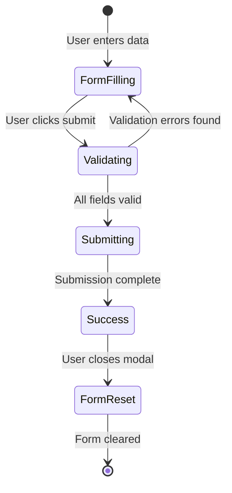

# Design Document: Event Planning Landing Page

## Overview

The event planning landing page is a single-page web application that provides a form interface for users to request quotes for event services. The application is frontend-only and focuses on collecting user requirements through an intuitive, accessible, and responsive form interface.

The design emphasizes user experience with clear visual feedback, comprehensive validation, and accessibility compliance. The form collects three main categories of information: event services needed, event details, and contact information.

## Architecture

The application follows a component-based architecture with clear separation of concerns:

```
┌─────────────────────────────────────────┐
│         Landing Page Container          │
│  ┌───────────────────────────────────┐  │
│  │         Header Section            │  │
│  │  - Title                          │  │
│  │  - Description                    │  │
│  └───────────────────────────────────┘  │
│  ┌───────────────────────────────────┐  │
│  │      Service Form Component       │  │
│  │  ┌─────────────────────────────┐  │  │
│  │  │  Service Selection Section  │  │  │
│  │  └─────────────────────────────┘  │  │
│  │  ┌─────────────────────────────┐  │  │
│  │  │  Event Details Section      │  │  │
│  │  └─────────────────────────────┘  │  │
│  │  ┌─────────────────────────────┐  │  │
│  │  │  Contact Info Section       │  │  │
│  │  └─────────────────────────────┘  │  │
│  │  ┌─────────────────────────────┐  │  │
│  │  │  Form Actions (Submit)      │  │  │
│  │  └─────────────────────────────┘  │  │
│  └───────────────────────────────────┘  │
│  ┌───────────────────────────────────┐  │
│  │    Confirmation Modal (hidden)    │  │
│  └───────────────────────────────────┘  │
└─────────────────────────────────────────┘
```

**Technology Stack:**
- HTML5 for semantic markup
- CSS3 for styling and responsive design
- JavaScript (ES6+) for form validation and interactivity
- No external frameworks required (vanilla implementation)

**Component Hierarchy:**
1. **Landing Page Container**: Root component managing overall layout
2. **Service Form Component**: Main form containing all input sections
3. **Form Sections**: Logical groupings of related inputs
4. **Input Components**: Individual form fields with validation
5. **Confirmation Modal**: Success message display

## Components and Interfaces

### 1. Landing Page Container

**Responsibility:** Manages the overall page layout and responsive behavior.

**Structure:**
```javascript
class LandingPage {
  constructor() {
    this.form = null;
    this.modal = null;
  }
  
  initialize() {
    // Set up form and modal components
    // Attach event listeners
    // Initialize responsive behavior
  }
  
  render() {
    // Render the complete page structure
  }
}
```

### 2. Service Form Component

**Responsibility:** Manages form state, validation, and submission.

**Structure:**
```javascript
class ServiceForm {
  constructor() {
    this.formData = {
      services: [],
      eventDate: '',
      attendees: '',
      location: '',
      eventType: '',
      notes: '',
      name: '',
      email: '',
      phone: ''
    };
    this.errors = {};
    this.isSubmitting = false;
  }
  
  validateField(fieldName, value) {
    // Validate individual field
    // Return error message or null
  }
  
  validateForm() {
    // Validate entire form
    // Return true if valid, false otherwise
  }
  
  handleSubmit(event) {
    // Prevent default submission
    // Validate form
    // Display confirmation
    // Reset form
  }
  
  updateField(fieldName, value) {
    // Update form data
    // Trigger validation
    // Update UI
  }
}
```

### 3. Service Selection Component

**Responsibility:** Manages multiple service category selections.

**Available Services:**
- Catering
- Venue
- Photography
- Entertainment
- Decoration
- Other

**Interface:**
```javascript
class ServiceSelector {
  constructor() {
    this.selectedServices = new Set();
  }
  
  toggleService(serviceName) {
    // Add or remove service from selection
    // Update visual state
    // Trigger validation
  }
  
  getSelectedServices() {
    // Return array of selected services
  }
  
  hasSelection() {
    // Return true if at least one service selected
  }
}
```

### 4. Input Field Component

**Responsibility:** Manages individual form input with validation and error display.

**Interface:**
```javascript
class InputField {
  constructor(name, type, label, required, validator) {
    this.name = name;
    this.type = type;
    this.label = label;
    this.required = required;
    this.validator = validator;
    this.value = '';
    this.error = null;
  }
  
  validate() {
    // Run validator function
    // Set error message if invalid
    // Return validation result
  }
  
  render() {
    // Render input with label and error message
  }
  
  updateValue(newValue) {
    // Update value
    // Trigger validation
    // Update UI
  }
}
```

### 5. Validation Module

**Responsibility:** Provides validation functions for different input types.

**Validators:**
```javascript
const Validators = {
  required: (value) => {
    return value && value.trim().length > 0 
      ? null 
      : 'This field is required';
  },
  
  email: (value) => {
    const emailRegex = /^[^\s@]+@[^\s@]+\.[^\s@]+$/;
    return emailRegex.test(value) 
      ? null 
      : 'Please enter a valid email address';
  },
  
  phone: (value) => {
    const phoneRegex = /^[\d\s\-\+\(\)]+$/;
    return phoneRegex.test(value) && value.replace(/\D/g, '').length >= 10
      ? null 
      : 'Please enter a valid phone number';
  },
  
  futureDate: (value) => {
    const selectedDate = new Date(value);
    const today = new Date();
    today.setHours(0, 0, 0, 0);
    return selectedDate >= today 
      ? null 
      : 'Event date must be today or in the future';
  },
  
  positiveNumber: (value) => {
    const num = parseInt(value, 10);
    return num > 0 
      ? null 
      : 'Please enter a number greater than 0';
  },
  
  atLeastOneService: (services) => {
    return services.length > 0 
      ? null 
      : 'Please select at least one service';
  }
};
```

### 6. Confirmation Modal Component

**Responsibility:** Displays success message after form submission.

**Interface:**
```javascript
class ConfirmationModal {
  constructor() {
    this.isVisible = false;
  }
  
  show(message) {
    // Display modal with message
    // Set up close handlers
  }
  
  hide() {
    // Hide modal
    // Clean up event listeners
  }
  
  render() {
    // Render modal structure
  }
}
```

## Data Models

### FormData Model

Represents the complete form submission data:

```javascript
{
  services: string[],           // Array of selected service names
  eventDate: string,            // ISO date string (YYYY-MM-DD)
  attendees: number,            // Expected number of attendees
  location: string,             // Event location or preferred area
  eventType: string,            // Type of event (wedding, corporate, etc.)
  notes: string,                // Optional additional details
  name: string,                 // User's full name
  email: string,                // User's email address
  phone: string                 // User's phone number
}
```

**Validation Rules:**
- `services`: Must contain at least one service
- `eventDate`: Required, must be today or future date
- `attendees`: Required, must be positive integer
- `location`: Required, non-empty string
- `eventType`: Required, non-empty string
- `notes`: Optional
- `name`: Required, non-empty string
- `email`: Required, must match email format
- `phone`: Required, must match phone format

### Error Model

Represents validation errors for the form:

```javascript
{
  [fieldName: string]: string | null
}
```

Each field name maps to either an error message (string) or null if valid.

## Responsive Design Strategy

### Breakpoints

- **Mobile**: 320px - 767px
- **Tablet**: 768px - 1023px
- **Desktop**: 1024px and above

### Layout Adaptations

**Mobile (320px - 767px):**
- Single column layout
- Full-width form elements
- Stacked service selection buttons
- Larger touch targets (minimum 44px height)
- Reduced padding and margins

**Tablet (768px - 1023px):**
- Single column layout with increased padding
- Service selection in 2-column grid
- Moderate spacing

**Desktop (1024px+):**
- Centered form with max-width (800px)
- Service selection in 3-column grid
- Generous spacing and padding
- Side-by-side layout for related fields (e.g., name and email)

### CSS Media Queries

```css
/* Mobile-first base styles */
.service-form {
  padding: 1rem;
  max-width: 100%;
}

/* Tablet */
@media (min-width: 768px) {
  .service-form {
    padding: 2rem;
  }
  
  .service-grid {
    grid-template-columns: repeat(2, 1fr);
  }
}

/* Desktop */
@media (min-width: 1024px) {
  .service-form {
    padding: 3rem;
    max-width: 800px;
    margin: 0 auto;
  }
  
  .service-grid {
    grid-template-columns: repeat(3, 1fr);
  }
  
  .contact-row {
    display: grid;
    grid-template-columns: 1fr 1fr;
    gap: 1rem;
  }
}
```

## Accessibility Implementation

### Semantic HTML

- Use `<form>` element for the form
- Use `<label>` elements associated with inputs via `for` attribute
- Use `<button>` for submit action
- Use appropriate input types (`email`, `tel`, `date`, `number`)
- Use `<fieldset>` and `<legend>` for service selection group

### ARIA Attributes

```html
<!-- Form with ARIA labels -->
<form role="form" aria-label="Event service quote request form">
  
  <!-- Service selection -->
  <fieldset aria-describedby="service-help">
    <legend>Select Services</legend>
    <p id="service-help">Choose all services you need for your event</p>
    <!-- Service checkboxes -->
  </fieldset>
  
  <!-- Input with error -->
  <div class="form-group">
    <label for="email">Email Address</label>
    <input 
      id="email" 
      type="email" 
      aria-required="true"
      aria-invalid="false"
      aria-describedby="email-error"
    />
    <span id="email-error" role="alert" aria-live="polite"></span>
  </div>
  
  <!-- Submit button -->
  <button 
    type="submit" 
    aria-disabled="false"
  >
    Request Quotes
  </button>
</form>
```

### Keyboard Navigation

- All interactive elements must be keyboard accessible
- Tab order follows logical reading order
- Enter key submits form
- Space key toggles service checkboxes
- Focus indicators visible on all interactive elements

### Error Handling for Accessibility

- Error messages announced via `aria-live="polite"`
- `aria-invalid="true"` set on fields with errors
- Error messages associated with fields via `aria-describedby`
- Sufficient color contrast (WCAG AA: 4.5:1 for normal text)
- Error indication not relying solely on color (use icons + text)

## Visual Design Specifications

### Color Scheme

```css
:root {
  /* Primary colors */
  --primary-color: #4F46E5;      /* Indigo - primary actions */
  --primary-hover: #4338CA;      /* Darker indigo - hover state */
  --primary-light: #EEF2FF;      /* Light indigo - backgrounds */
  
  /* Semantic colors */
  --success-color: #10B981;      /* Green - success messages */
  --error-color: #EF4444;        /* Red - error messages */
  --warning-color: #F59E0B;      /* Amber - warnings */
  
  /* Neutral colors */
  --text-primary: #1F2937;       /* Dark gray - main text */
  --text-secondary: #6B7280;     /* Medium gray - secondary text */
  --border-color: #D1D5DB;       /* Light gray - borders */
  --background: #FFFFFF;         /* White - backgrounds */
  --background-alt: #F9FAFB;     /* Off-white - alternate backgrounds */
}
```

### Typography

```css
:root {
  /* Font families */
  --font-primary: -apple-system, BlinkMacSystemFont, 'Segoe UI', Roboto, 
                  'Helvetica Neue', Arial, sans-serif;
  
  /* Font sizes */
  --text-xs: 0.75rem;    /* 12px */
  --text-sm: 0.875rem;   /* 14px */
  --text-base: 1rem;     /* 16px */
  --text-lg: 1.125rem;   /* 18px */
  --text-xl: 1.25rem;    /* 20px */
  --text-2xl: 1.5rem;    /* 24px */
  --text-3xl: 1.875rem;  /* 30px */
  
  /* Line heights */
  --leading-tight: 1.25;
  --leading-normal: 1.5;
  --leading-relaxed: 1.75;
}
```

### Spacing System

```css
:root {
  --space-1: 0.25rem;   /* 4px */
  --space-2: 0.5rem;    /* 8px */
  --space-3: 0.75rem;   /* 12px */
  --space-4: 1rem;      /* 16px */
  --space-5: 1.25rem;   /* 20px */
  --space-6: 1.5rem;    /* 24px */
  --space-8: 2rem;      /* 32px */
  --space-10: 2.5rem;   /* 40px */
  --space-12: 3rem;     /* 48px */
}
```

### Component Styles

**Input Fields:**
```css
.form-input {
  padding: var(--space-3) var(--space-4);
  border: 1px solid var(--border-color);
  border-radius: 0.375rem;
  font-size: var(--text-base);
  line-height: var(--leading-normal);
  transition: border-color 0.2s, box-shadow 0.2s;
}

.form-input:focus {
  outline: none;
  border-color: var(--primary-color);
  box-shadow: 0 0 0 3px var(--primary-light);
}

.form-input.error {
  border-color: var(--error-color);
}
```

**Service Selection Buttons:**
```css
.service-option {
  padding: var(--space-4);
  border: 2px solid var(--border-color);
  border-radius: 0.5rem;
  cursor: pointer;
  transition: all 0.2s;
  background: var(--background);
}

.service-option:hover {
  border-color: var(--primary-color);
  background: var(--primary-light);
}

.service-option.selected {
  border-color: var(--primary-color);
  background: var(--primary-light);
  box-shadow: 0 0 0 3px var(--primary-light);
}
```

**Submit Button:**
```css
.submit-button {
  padding: var(--space-3) var(--space-6);
  background: var(--primary-color);
  color: white;
  border: none;
  border-radius: 0.5rem;
  font-size: var(--text-lg);
  font-weight: 600;
  cursor: pointer;
  transition: background 0.2s;
}

.submit-button:hover:not(:disabled) {
  background: var(--primary-hover);
}

.submit-button:disabled {
  opacity: 0.5;
  cursor: not-allowed;
}
```

## Form Submission Flow

Since this is a frontend-only application, the form submission will simulate the quote request process:



**Submission Process:**

1. **User clicks submit button**
   - Prevent default form submission
   - Disable submit button
   - Show loading state

2. **Validate all fields**
   - Run all validators
   - If errors found: display errors, re-enable button, stop
   - If valid: proceed to submission

3. **Simulate submission**
   - Log form data to console (for demonstration)
   - Wait brief moment (simulate network request)
   - Store data in localStorage (optional, for demo purposes)

4. **Display confirmation**
   - Show success modal
   - Display confirmation message
   - Provide option to submit another request

5. **Reset form**
   - Clear all form fields
   - Reset validation state
   - Re-enable submit button
   - Return focus to first field

## Correctness Properties

*A property is a characteristic or behavior that should hold true across all valid executions of a system—essentially, a formal statement about what the system should do. Properties serve as the bridge between human-readable specifications and machine-verifiable correctness guarantees.*

### Property 1: Service Selection State Management

*For any* service category in the form, when a user selects it, the visual state should update to indicate selection, and multiple services should be simultaneously selectable.

**Validates: Requirements 1.3, 1.4**

### Property 2: Email Format Validation

*For any* string entered in the email field, the validation should return an error if and only if the string does not match a valid email format (contains @ symbol with text before and after, and a domain with at least one dot).

**Validates: Requirements 3.4, 4.3**

### Property 3: Required Field Validation

*For any* required field in the form, when that field is empty or contains only whitespace, attempting to submit should prevent submission and display an error message for that specific field.

**Validates: Requirements 4.1, 4.2**

### Property 4: Past Date Rejection

*For any* date value that is before today's date, the date validation should fail and display an error message indicating the date must be today or in the future.

**Validates: Requirements 4.4**

### Property 5: Valid Form Enables Submission

*For any* form state where all required fields contain valid data and at least one service is selected, the submit button should be enabled and clickable.

**Validates: Requirements 5.1**

### Property 6: Successful Submission Shows Confirmation

*For any* valid form submission, after the submission completes, a confirmation message should be displayed to the user.

**Validates: Requirements 5.2**

### Property 7: Form Reset After Submission

*For any* successful form submission, all input fields should be cleared and reset to their initial empty state.

**Validates: Requirements 5.4**

### Property 8: Input Labels Association

*For any* input field in the form, there should be an associated label element that is properly linked via the `for` attribute or wrapping structure.

**Validates: Requirements 6.2**

### Property 9: Keyboard Navigation

*For any* interactive element in the form (inputs, buttons, checkboxes), it should be reachable and operable using only keyboard controls (Tab, Enter, Space).

**Validates: Requirements 6.3**

### Property 10: ARIA Attributes Presence

*For any* form input element, appropriate ARIA attributes should be present including `aria-required` for required fields, `aria-invalid` for fields with errors, and `aria-describedby` for error messages.

**Validates: Requirements 6.4**

### Property 11: Error Message Accessibility

*For any* error message displayed, it should have sufficient color contrast (minimum 4.5:1 ratio) and include non-color indicators (such as icons or text) to convey the error state.

**Validates: Requirements 6.5**

### Property 12: Consistent Color Usage

*For any* two instances of the same UI element type (e.g., two input fields, two buttons), they should use the same color values from the defined color scheme.

**Validates: Requirements 8.1**

### Property 13: Interactive Element States

*For any* interactive form element, it should have defined hover and focus states that provide visual feedback when users interact with it.

**Validates: Requirements 8.5**


## Error Handling

### Validation Error Handling

**Field-Level Errors:**
- Validate on blur (when user leaves field)
- Validate on submit attempt
- Display error message below the field
- Add error styling to the field (red border)
- Set `aria-invalid="true"` on the field
- Announce error via `aria-live="polite"` region

**Form-Level Errors:**
- Validate all fields on submit
- Prevent submission if any errors exist
- Scroll to first error field
- Focus first error field
- Display summary of errors (optional)

**Error Message Guidelines:**
- Be specific about what's wrong
- Provide guidance on how to fix
- Use friendly, non-technical language
- Examples:
  - ❌ "Invalid input"
  - ✅ "Please enter a valid email address (e.g., name@example.com)"

### User Input Edge Cases

**Empty/Whitespace Input:**
```javascript
function isEmptyOrWhitespace(value) {
  return !value || value.trim().length === 0;
}
```

**Special Characters in Text Fields:**
- Allow all Unicode characters in name and location fields
- Sanitize for display (escape HTML entities)
- No server-side processing, so XSS not a concern for this frontend-only app

**Phone Number Formats:**
- Accept various formats: (123) 456-7890, 123-456-7890, 1234567890
- Validate minimum 10 digits
- Don't enforce specific format (international users)

**Date Edge Cases:**
- Handle invalid dates (e.g., February 30)
- Handle timezone differences (use local date)
- Today's date should be valid
- Far future dates (10+ years) should be valid

### Network/Submission Error Handling

Since this is frontend-only with no actual backend:

**Simulated Success:**
- Always succeed after brief delay
- Log data to console
- Optionally store in localStorage

**Future Backend Integration:**
- Add try-catch around submission
- Handle network errors gracefully
- Display user-friendly error message
- Allow retry without losing form data

```javascript
async handleSubmit(formData) {
  try {
    // Simulate API call
    await new Promise(resolve => setTimeout(resolve, 1000));
    console.log('Form submitted:', formData);
    
    // Future: Replace with actual API call
    // const response = await fetch('/api/quotes', {
    //   method: 'POST',
    //   headers: { 'Content-Type': 'application/json' },
    //   body: JSON.stringify(formData)
    // });
    
    return { success: true };
  } catch (error) {
    console.error('Submission error:', error);
    return { 
      success: false, 
      message: 'Unable to submit request. Please try again.' 
    };
  }
}
```

## Testing Strategy

### Dual Testing Approach

This feature requires both unit tests and property-based tests for comprehensive coverage:

- **Unit tests**: Verify specific examples, edge cases, and error conditions
- **Property tests**: Verify universal properties across all inputs

Both testing approaches are complementary and necessary. Unit tests catch concrete bugs with specific inputs, while property tests verify general correctness across many generated inputs.

### Property-Based Testing

**Library Selection:**
- **JavaScript**: Use `fast-check` library for property-based testing
- Install: `npm install --save-dev fast-check`

**Configuration:**
- Minimum 100 iterations per property test
- Each test must reference its design document property
- Tag format: `// Feature: event-planning-landing-page, Property N: [property text]`

**Property Test Examples:**

```javascript
import fc from 'fast-check';

// Feature: event-planning-landing-page, Property 2: Email Format Validation
test('email validation accepts valid emails and rejects invalid ones', () => {
  fc.assert(
    fc.property(
      fc.emailAddress(),
      (validEmail) => {
        const result = Validators.email(validEmail);
        expect(result).toBeNull(); // Valid emails return null (no error)
      }
    ),
    { numRuns: 100 }
  );
  
  fc.assert(
    fc.property(
      fc.string().filter(s => !s.includes('@') || !s.includes('.')),
      (invalidEmail) => {
        const result = Validators.email(invalidEmail);
        expect(result).not.toBeNull(); // Invalid emails return error message
      }
    ),
    { numRuns: 100 }
  );
});

// Feature: event-planning-landing-page, Property 3: Required Field Validation
test('required field validation rejects empty and whitespace-only values', () => {
  fc.assert(
    fc.property(
      fc.string().filter(s => s.trim().length === 0),
      (emptyOrWhitespace) => {
        const result = Validators.required(emptyOrWhitespace);
        expect(result).not.toBeNull(); // Should return error message
        expect(result).toContain('required');
      }
    ),
    { numRuns: 100 }
  );
});

// Feature: event-planning-landing-page, Property 4: Past Date Rejection
test('date validation rejects past dates', () => {
  fc.assert(
    fc.property(
      fc.date({ max: new Date(Date.now() - 86400000) }), // Dates before today
      (pastDate) => {
        const dateString = pastDate.toISOString().split('T')[0];
        const result = Validators.futureDate(dateString);
        expect(result).not.toBeNull(); // Should return error message
      }
    ),
    { numRuns: 100 }
  );
});

// Feature: event-planning-landing-page, Property 7: Form Reset After Submission
test('form clears all fields after successful submission', () => {
  fc.assert(
    fc.property(
      fc.record({
        services: fc.array(fc.string(), { minLength: 1 }),
        eventDate: fc.date({ min: new Date() }).map(d => d.toISOString().split('T')[0]),
        attendees: fc.integer({ min: 1, max: 10000 }),
        location: fc.string({ minLength: 1 }),
        eventType: fc.string({ minLength: 1 }),
        name: fc.string({ minLength: 1 }),
        email: fc.emailAddress(),
        phone: fc.string({ minLength: 10 })
      }),
      async (formData) => {
        const form = new ServiceForm();
        // Populate form with data
        Object.keys(formData).forEach(key => {
          form.updateField(key, formData[key]);
        });
        
        // Submit form
        await form.handleSubmit();
        
        // Check all fields are cleared
        Object.values(form.formData).forEach(value => {
          if (Array.isArray(value)) {
            expect(value).toHaveLength(0);
          } else {
            expect(value).toBe('');
          }
        });
      }
    ),
    { numRuns: 100 }
  );
});
```

### Unit Testing

**Focus Areas:**
- Specific examples demonstrating correct behavior
- Edge cases (empty strings, special characters, boundary values)
- Error conditions and error messages
- Integration between components
- UI state changes

**Unit Test Examples:**

```javascript
// Test specific form structure
test('form contains all required fields', () => {
  const form = new ServiceForm();
  const rendered = form.render();
  
  expect(rendered).toContain('eventDate');
  expect(rendered).toContain('attendees');
  expect(rendered).toContain('location');
  expect(rendered).toContain('eventType');
  expect(rendered).toContain('name');
  expect(rendered).toContain('email');
  expect(rendered).toContain('phone');
});

// Test specific service options
test('form displays required service categories', () => {
  const form = new ServiceForm();
  const rendered = form.render();
  
  expect(rendered).toContain('Catering');
  expect(rendered).toContain('Venue');
  expect(rendered).toContain('Photography');
  expect(rendered).toContain('Entertainment');
  expect(rendered).toContain('Decoration');
});

// Test edge case: no services selected
test('form prevents submission when no services selected', () => {
  const form = new ServiceForm();
  form.formData.services = [];
  
  const isValid = form.validateForm();
  
  expect(isValid).toBe(false);
  expect(form.errors.services).toContain('at least one service');
});

// Test edge case: phone number with various formats
test('phone validator accepts various formats', () => {
  expect(Validators.phone('(123) 456-7890')).toBeNull();
  expect(Validators.phone('123-456-7890')).toBeNull();
  expect(Validators.phone('1234567890')).toBeNull();
  expect(Validators.phone('+1 123 456 7890')).toBeNull();
});

// Test error message display
test('invalid email shows descriptive error message', () => {
  const result = Validators.email('notanemail');
  
  expect(result).not.toBeNull();
  expect(result).toContain('valid email');
});

// Test button state during submission
test('submit button is disabled during submission', async () => {
  const form = new ServiceForm();
  // Set up valid form data
  form.formData = {
    services: ['Catering'],
    eventDate: '2025-12-31',
    attendees: 50,
    location: 'New York',
    eventType: 'Wedding',
    name: 'John Doe',
    email: 'john@example.com',
    phone: '1234567890'
  };
  
  const submitPromise = form.handleSubmit();
  
  expect(form.isSubmitting).toBe(true);
  
  await submitPromise;
  
  expect(form.isSubmitting).toBe(false);
});
```

### Accessibility Testing

**Manual Testing Checklist:**
- [ ] Navigate entire form using only keyboard (Tab, Shift+Tab, Enter, Space)
- [ ] Test with screen reader (NVDA, JAWS, or VoiceOver)
- [ ] Verify color contrast using browser dev tools or online checker
- [ ] Test with browser zoom at 200%
- [ ] Test with CSS disabled (content still makes sense)

**Automated Accessibility Testing:**
- Use `axe-core` or `jest-axe` for automated accessibility checks
- Run on rendered components
- Check for WCAG AA compliance

```javascript
import { axe, toHaveNoViolations } from 'jest-axe';

expect.extend(toHaveNoViolations);

test('form has no accessibility violations', async () => {
  const form = new ServiceForm();
  const container = document.createElement('div');
  container.innerHTML = form.render();
  
  const results = await axe(container);
  
  expect(results).toHaveNoViolations();
});
```

### Responsive Design Testing

**Manual Testing:**
- Test at breakpoints: 320px, 768px, 1024px, 1920px
- Test on actual devices (mobile phone, tablet)
- Test in browser responsive mode
- Verify touch targets are minimum 44px on mobile

**Automated Testing:**
- Use viewport testing in test framework
- Verify CSS media queries apply correctly

```javascript
test('form adapts layout for mobile viewport', () => {
  // Set viewport to mobile size
  global.innerWidth = 375;
  global.dispatchEvent(new Event('resize'));
  
  const form = new ServiceForm();
  const styles = window.getComputedStyle(form.element);
  
  // Verify mobile-specific styles applied
  expect(styles.gridTemplateColumns).toBe('1fr');
});
```

### Integration Testing

**Test Complete User Flows:**

```javascript
test('complete form submission flow', async () => {
  const page = new LandingPage();
  page.initialize();
  
  // User selects services
  page.form.serviceSelector.toggleService('Catering');
  page.form.serviceSelector.toggleService('Venue');
  
  // User fills in event details
  page.form.updateField('eventDate', '2025-12-31');
  page.form.updateField('attendees', '100');
  page.form.updateField('location', 'New York');
  page.form.updateField('eventType', 'Wedding');
  
  // User fills in contact info
  page.form.updateField('name', 'Jane Smith');
  page.form.updateField('email', 'jane@example.com');
  page.form.updateField('phone', '5551234567');
  
  // User submits form
  await page.form.handleSubmit();
  
  // Verify confirmation modal shown
  expect(page.modal.isVisible).toBe(true);
  
  // Verify form is reset
  expect(page.form.formData.services).toHaveLength(0);
  expect(page.form.formData.name).toBe('');
});
```

### Test Coverage Goals

- **Unit test coverage**: Minimum 80% code coverage
- **Property test coverage**: All 13 correctness properties implemented
- **Accessibility**: Zero critical violations
- **Browser compatibility**: Test in Chrome, Firefox, Safari, Edge

### Continuous Testing

- Run tests on every commit
- Run accessibility tests in CI/CD pipeline
- Run visual regression tests for UI changes
- Monitor test execution time (keep under 30 seconds for fast feedback)
